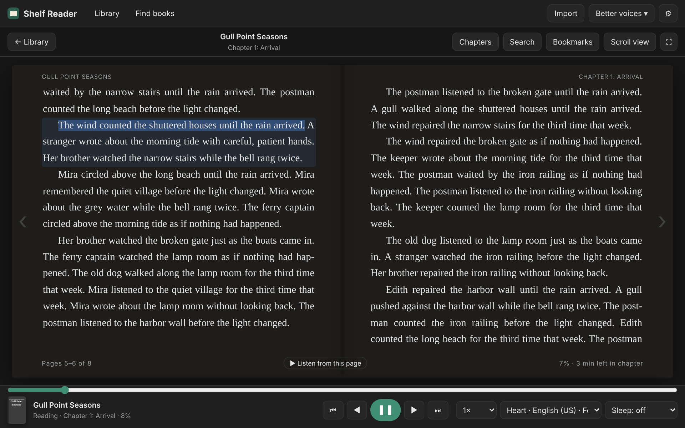
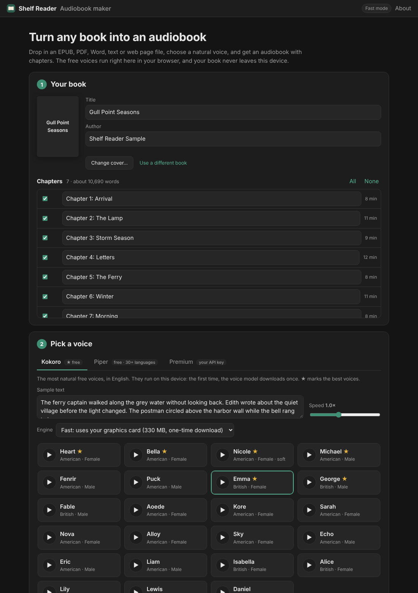

# 📚 Shelf Reader

An Android ebook reader that finds free, legal books and **reads them aloud** with your phone's natural voices, including Google's. It keeps reading with the screen off, like an audiobook.


<p align="center">
  
</p>

<table>
  <tr>
    <td></td>
    <td></td>
  </tr>
  <tr>
    <td align="center"><sub>Book view: turn pages like a real book while it reads aloud</sub></td>
    <td align="center"><sub>Chapters from the book's table of contents</sub></td>
  </tr>
  <tr>
    <td></td>
    <td></td>
  </tr>
  <tr>
    <td align="center"><sub>Grid view with progress bars</sub></td>
    <td align="center"><sub>Themes, fonts, pronunciation fixes, backup</sub></td>
  </tr>
</table>

<sub>Screenshots from the Windows app in dark mode. The sample book text was written for these screenshots.</sub>

---

## Audiobook maker



A drag-and-drop page that turns a book into audiobook files. Open it from the **Audiobook maker** button in the PC app, or host it with GitHub Pages (see below).

1. **Drop a book:** EPUB, PDF, Word (.docx), TXT, Markdown or HTML. You can also paste text. Chapters, title, author and cover are read from the file. Untick chapters you don't want, and rename any of them.
   - **Cover art:** use the book's own cover, or press **Change cover art…** to pick a published cover (Open Library), free-licensed art (Openverse or Wikimedia Commons, with the credit saved in the files), an original designed cover, or your own picture. Crop it square for audiobook apps or book-shaped, and add the title if you like.
2. **Pick a voice and hear it first:** press ▶ on any voice to hear your own book's opening, at the speed you choose.
   - **Kokoro:** 23 natural English voices, free. They run on your computer, and the model downloads once (90 MB, or 330 MB for the faster graphics-card engine).
   - **Piper:** free voices in 30+ languages. Each voice downloads once.
   - **Premium:** OpenAI (with a narration-style box), ElevenLabs, Microsoft Azure or Google Cloud, using your own API key. The key is only sent to that service and is saved only if you tick "Remember".
   - **Reading style:** Natural, Cozy bedtime, Suspense, Nonfiction, Children's story or Dramatic. Each one sets the pace and pauses, and premium voices also change how they perform. With OpenAI you can describe each character too ("gruff old fisherman").
   - **Natural pauses:** longer at scene breaks (`* * *`), a beat after lines that trail off…, a quick cut on interrupted lines—, and snappier back-and-forth dialogue. Each line is sent with the text around it, so premium voices keep the tone flowing.
   - **Dialogue voices:** have a second voice read everything in quotes, or give **each character their own voice**. Characters are found from lines like *“…,” said Mara*, from *she said* and from back-and-forth exchanges, with a guess at whether each one is a man or a woman. Voices are picked automatically (change any of them), each character's ▶ plays one of their own lines, and **Hear a conversation** previews the busiest scene in the book.
3. **Export options:**
   - **M4B audiobook:** one file with chapters, cover and tags (Chrome, Edge or Safari).
   - **MP3:** works everywhere, with chapter markers and cover.
   - **WAV:** for editing.
   - Whole book in one file, or one file per chapter.
   - 48–128 kbps quality.
   - Pauses between chapters and paragraphs.
   - Optional spoken title, author and chapter names.
   - Footnote markers and web links are skipped.
   - **Sound:** evens out the volume so every voice and chapter is equally loud, adds an optional soft room tone so pauses aren't dead silence, and can play a short music cue (chime, warm pad or piano notes) between chapters.
4. **Make it:** files download (several come as one .zip), or are saved into a folder you choose. Folder mode saves each chapter as soon as it's done and can pick up where it stopped. **Preview the first minute** checks everything before you start a long book.

Your book never leaves your device, except when you choose a premium voice. That voice's text goes to the service you picked.

**Hosting it as a web page:** GitHub Pages needs a public repository (or a paid plan for private ones). Go to **Settings → Pages**, choose **Deploy from a branch**, pick `main` and `/ (root)`, and the maker will be at `https://<your-user>.github.io/shelf-reader/`. Making the repository public also lets the apps' **Check for updates** button work.

## Install

### Android
1. On your phone, open the **[latest release](../../releases/latest)** and download **`ShelfReader.apk`**.
2. Open the file. If Android asks, allow installs from your browser or file manager.
3. Done. After that, the app can update itself (see [Updates](#updates)).

> Requires Android 8.0 or newer.

### Windows
1. Open the **[latest release](../../releases/latest)** on your PC.
2. Download **`ShelfReader-Setup.exe`** to install it, or **`ShelfReader-Windows.zip`** to run it without installing (unzip it, then open `Shelf Reader.exe`).
3. Windows may show *“Windows protected your PC”* because the app isn't code-signed. Click **More info → Run anyway**.
4. If Microsoft Defender quarantines it, that's a false positive common with new, unsigned apps. You can restore it under *Windows Security → Virus & threat protection → Protection history* (only do this for files you downloaded from this repo's Releases page), and report it to Microsoft as a false positive at https://www.microsoft.com/en-us/wdsi/filesubmission.

The desktop app has the same library, cover shelf, search, reader, chapters, bookmarks and notes, collections, sleep timer, pronunciation fixes and themes. Extras on PC:
- **Voice options** (*Better voices ▾ → Natural & premium voices*, or *Settings*):
  - **Kokoro natural voices** (free, recommended): open-source neural voices that run on your PC (Heart, Bella, Michael, Emma, George and more, with US and UK accents). One download of about 90 MB, then they work offline for listening **and** MP3 export.
  - **Piper voices** (free): 100+ lighter voices in many languages, downloaded one at a time.
  - **Premium cloud voices** with your own API key: **OpenAI**, **ElevenLabs**, **Microsoft Azure** and **Google Cloud** (Chirp 3 HD, Neural2, Studio). You pay the provider for what you use. Keys stay on your PC.
- **Better voices ▾** can also open your library in **Edge** (Microsoft's natural voices) or **Chrome** (Google's voices). Keep the app running while you listen there.
- **Readable voice names** like *Aria · English (US) · Female · Natural ★* or *Google · English (UK) · Male*. Choosing a voice plays a short preview.
- **Export as MP3:** in a book, click **Export audio** to save a chapter or the whole book (one file per chapter) with a Kokoro, Piper or premium voice. Browser and Windows voices can't be recorded.
- **Bring your phone library over:** on the phone use *Menu → Back up library*, copy the `.zip` to your PC, and drop it on the app window (or *Settings → Restore from backup*). Books, places, notes and collections come across.
- **Keyboard:** <kbd>Space</kbd> play/pause, <kbd>←</kbd>/<kbd>→</kbd> paragraph, <kbd>Shift</kbd>+<kbd>←</kbd>/<kbd>→</kbd> chapter, <kbd>B</kbd> bookmark, <kbd>C</kbd> chapters, <kbd>Ctrl</kbd>+<kbd>F</kbd> search. Media keys work too.
- **Drag and drop** EPUB, PDF or TXT files onto the window to add them.
- Select a word to **define** it. Right-click a paragraph for bookmarks and notes.

Android Auto is phone-only.

---


**Updates:** if you installed with **ShelfReader-Setup.exe**, Shelf Reader checks for new versions by itself, downloads them in the background, and installs them the next time you restart. A **Update ready · Restart** button also appears at the top. You only need to download the installer once. (The zip version can't update itself.) While this repository is private, add a read-only GitHub token in **Settings → Updates** so the app can see new releases. Once the repository is public, no token is needed.
## Features

### Find books
Search six free sources at once and download with one tap:

| Source | What's there |
|---|---|
| **Project Gutenberg** | 70,000+ public-domain classics |
| **Standard Ebooks** | Carefully proofread, well-formatted public-domain books |
| **Internet Archive** | Public-domain and open-access texts (lend-only books are excluded) |
| **Open Library** | Books with free full text, hosted on the Internet Archive |
| **Wikisource** | Public-domain texts transcribed by volunteers |
| **Feedbooks** | Free public-domain titles (paid books are filtered out) |

You can also **import** your own DRM-free **EPUB, PDF or TXT** files.

### Your library
- **Shelf view:** covers on wooden shelves. **Grid view:** covers with titles. **List view:** compact.
- Covers come from the book itself, the source website, or are drawn automatically. You can also pick your own photo.
- Progress bar on every cover, plus a **Continue** bar to jump back into your last book.
- Sort by recently read, title, author or progress.
- Long-press a book to read it aloud, edit its title and author, change its cover, or remove it.

### Read aloud
- Uses Android's text-to-speech, so **any voice installed on your phone** works, including Google's high-quality voices.
- **Easy voice picker:** voices get readable names like *English (US) · Female 2* or *English (UK) · Male 1*, and tapping one plays a preview.
- **Highlights each sentence** as it's spoken.
- **Keeps playing in the background** with lock-screen, notification and headphone controls. Pauses for calls and when headphones are unplugged.
- Speed from **0.75× to 3×**, and a choice of voice.
- **Sleep timer:** 5 to 60 minutes, or the end of the chapter.
- **Skip clutter:** leaves out page numbers, footnote markers, links and scanning notices.
- **Pronunciation fixes:** teach it how to say names and words it gets wrong.

### Reading
- **Book view (phone and PC):** pages you turn instead of one long scroll. On the phone, swipe or tap the page edges; tap the middle to hide the buttons. On PC you get two-page spreads on wide windows, and you turn with the arrow keys, the mouse wheel or the page edges (**F** goes full screen). Page numbers, chapter headers, and chapters that start on a new page. While reading aloud, it turns the pages for you. **Scroll view** is one tap away.
- **Cover and contents pages:** each book opens on its cover, followed by a contents page you can tap.
- **Page turn style:** a quick slide or a 3D page flip.
- **Pictures:** illustrations from EPUB books show in the text.
- **Footnotes:** tap a `[1]` marker to read the note in a pop-up without losing your page.
- **Highlighters:** yellow, green or pink, with an optional note. **Export** all your highlights, notes and bookmarks as a Markdown file (on the phone, through the share menu: Drive, email, Keep…).
- **Chapter list** taken from the book's table of contents (or detected in plain text).
- **Bookmarks and notes:** long-press any paragraph.
- **Themes:** dark, light, sepia and black, with a choice of font, margins and text size. **Night mode schedule** switches to a dark theme between the hours you pick.
- **"Last time…" recap:** when you come back to a book, it shows the last sentence you heard and the chapter you were in.
- **Reading stats:** minutes read and listened each day, a daily goal, your streak, and books finished.
- **Phone ↔ PC sync:** keeps your place, bookmarks, highlights, notes, collections and stats the same on both devices through one small `ShelfReader-sync.json` file in Google Drive or OneDrive. Set it up in the PC app's **Settings → Sync** and the phone's **Menu → Sync with PC**. Books themselves aren't copied.
- Remembers your place in every book, down to the sentence.

### Ease of use
- **Book details before you download:** cover, description, year, length and popularity. Use **Download for later** to save a book to *Want to read*.
- **Collections:** *Want to read*, *Finished* (books are added automatically when you finish them) and your own collections. Filter the library by any of them.
- **Car mode:** a black screen with huge buttons, 30-second rewind and skip, and chapter jumps. The screen stays on.
- **Gestures:** tap a paragraph to read from it, double-tap to play or pause, swipe sideways to skip a paragraph.
- **Search inside a book**, and **look up any word** (long-press a paragraph → *Highlight, define or note a passage*, using the free dictionaryapi.dev).
- **Per-book voice and speed:** each book remembers its own.
- **Resume when headphones connect:** a paused book starts again when you plug in or connect Bluetooth headphones.
- **First-run voice guide** for getting Google's best voice, also in the main menu.
- **Backup and restore:** books, places, notes, collections and settings in one `.zip`, handy for a new phone.

### Extras
- **Export as audio:** save a chapter or the whole book as `.m4a` audio files (one per chapter) to any folder.
- **Home-screen widget** with play, pause and skip.
- **Android Auto:** browse your library and listen in the car. You'll need to enable *Unknown sources* in Android Auto's developer settings.

---

## Updates

Every push to `main` builds a new APK automatically and publishes it as a new release.

Inside the app, **Menu → Check for updates** (it also checks on its own every few hours) downloads the newest release and installs it over the current one. Your library is kept. Android will ask once to allow Shelf Reader to install apps.

> ⚠️ In-app updates read the public GitHub Releases API, so they **only work when this repository is public**. While it's private, download new APKs from the Releases page instead.

---

## Tips

- **Better voices:** go to *Settings → Accessibility → Text-to-speech*, choose *Speech Services by Google*, and download the high-quality voice for your language. Then pick it under *Voice* in the reader.
- **Tap any paragraph** to start reading from there.
- If reading stops when your screen is off, set Shelf Reader's battery usage to *Unrestricted* in Android's app settings.

---

## Building it yourself

**Desktop:** in `desktop/`, run `npm install`, then `npm start` to try it or `npm run dist` to build the Windows installers. You can also run just the library server with `node server.js` and open http://127.0.0.1:47321 in any browser.

**Android:**

GitHub Actions builds every push (see `.github/workflows/build.yml`). To build locally you need JDK 17 and the Android SDK:

```bash
gradle assembleRelease
# → app/build/outputs/apk/release/app-release.apk
```

The app is plain Kotlin with the Android framework. Its only library is [pdfbox-android](https://github.com/TomRoush/PdfBox-Android), used for reading PDF text.

| File | Purpose |
|---|---|
| `MainActivity.kt` | Library (shelf, grid, list), search, import, updates |
| `ReaderActivity.kt` | Reader, chapters, bookmarks, appearance, sleep timer |
| `TtsService.kt` | Background read-aloud, notification, media session, Android Auto |
| `Sources.kt` | Book source searches |
| `Extract.kt` | EPUB, PDF and TXT text and chapter extraction |
| `Speech.kt` | Sentence splitting, clutter skipping, pronunciation fixes |
| `Covers.kt` | Cover loading and generation |
| `ExportService.kt`, `Audio.kt` | Audio export (text-to-speech → AAC) |
| `ShelfWidget.kt` | Home-screen widget |
| `Updater.kt` | In-app updates from GitHub Releases |
| `CarModeActivity.kt` | Big-button car mode |
| `Backup.kt` | Backup and restore, dictionary lookups |
| `VoiceNames.kt` | Readable voice names |
| `desktop/` | Windows app (Electron): `server.js` local library server, `ui/` screens, `lib/` extraction, sources, storage, MP3 export |
| `desktop/ui/engines.js` | Kokoro, Piper and premium cloud voices; natural-voice MP3 export |
| `desktop/lib/cloud.js` | OpenAI, ElevenLabs, Azure and Google Cloud voice connections |
