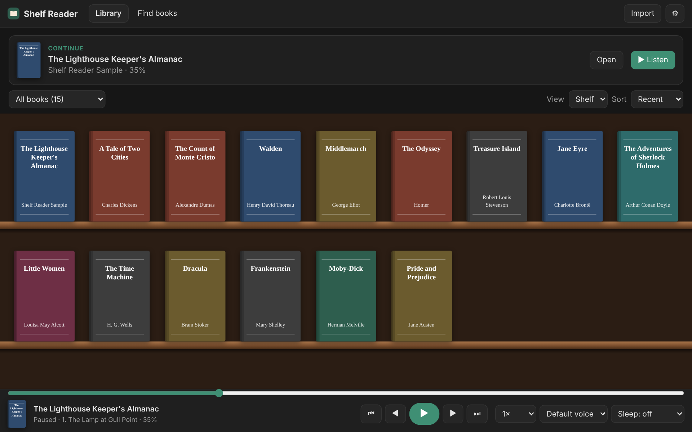
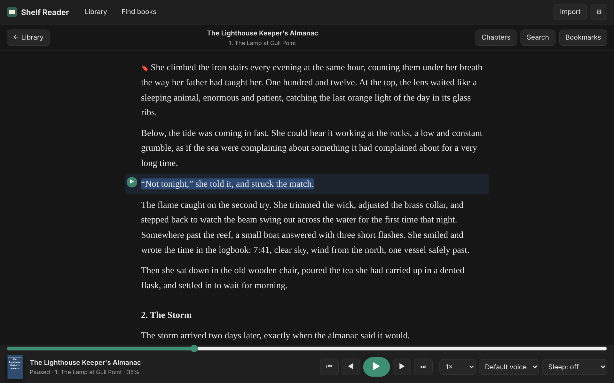
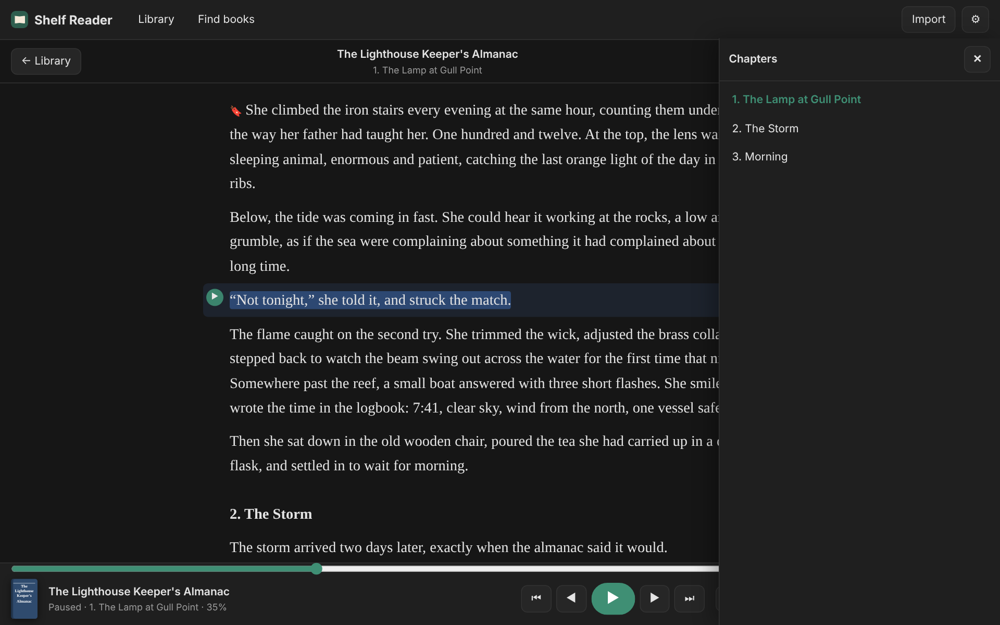
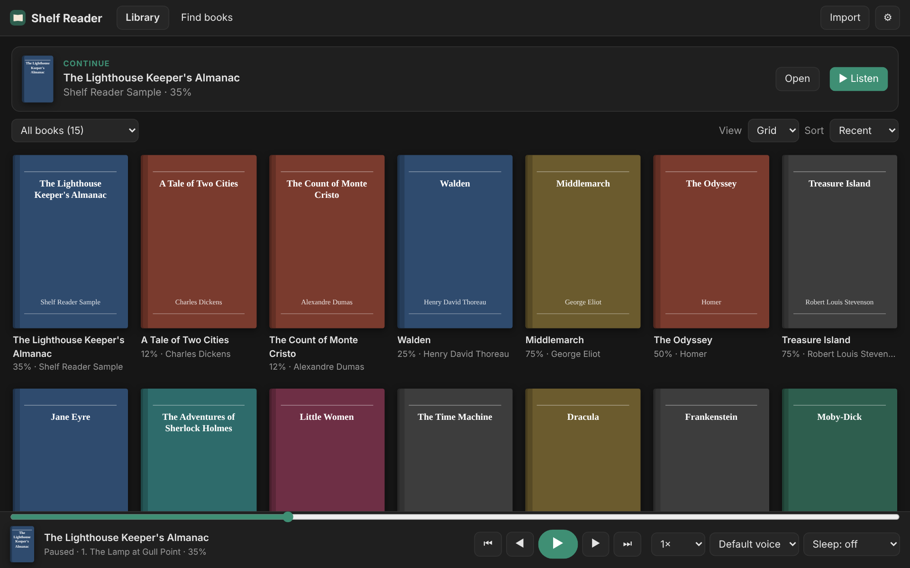
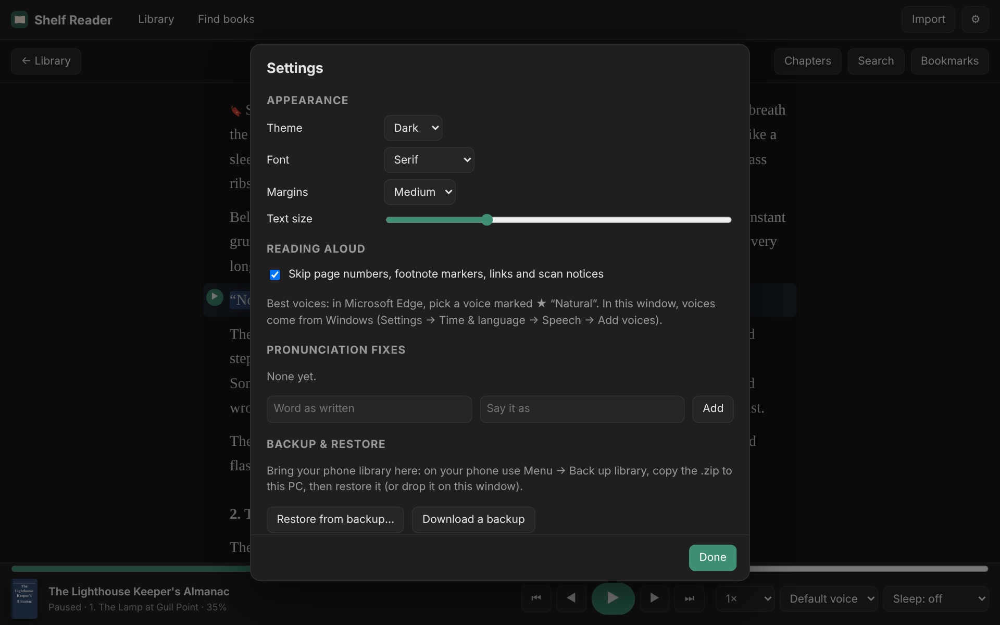

# 📚 Shelf Reader

An Android ebook reader that finds free, legal books and **reads them aloud** with your phone's natural voices, including Google's. It keeps reading with the screen off, like an audiobook.


<p align="center">
  
</p>

<table>
  <tr>
    <td></td>
    <td></td>
  </tr>
  <tr>
    <td align="center"><sub>Reading aloud: the current sentence is highlighted</sub></td>
    <td align="center"><sub>Chapters from the book's table of contents</sub></td>
  </tr>
  <tr>
    <td></td>
    <td></td>
  </tr>
  <tr>
    <td align="center"><sub>Grid view with progress bars</sub></td>
    <td align="center"><sub>Themes, fonts, pronunciation fixes, backup</sub></td>
  </tr>
</table>

<sub>Screenshots from the Windows app in dark mode. The sample book text was written for these screenshots.</sub>

---

## Install

### Android
1. On your phone, open the **[latest release](../../releases/latest)** and download **`ShelfReader.apk`**.
2. Open the file. If Android asks, allow installs from your browser or file manager.
3. Done. After that, the app can update itself (see [Updates](#updates)).

> Requires Android 8.0 or newer.

### Windows
1. Open the **[latest release](../../releases/latest)** on your PC.
2. Download **`ShelfReader-Setup.exe`** to install it, or **`ShelfReader-Portable.exe`** to run it without installing.
3. Windows may show *“Windows protected your PC”* because the app isn't code-signed. Click **More info → Run anyway**.

The desktop app has the same library, cover shelf, search, reader, chapters, bookmarks and notes, collections, sleep timer, pronunciation fixes and themes. Extras on PC:
- **Open in Edge:** opens your library in Microsoft Edge, which offers very natural “Online (Natural)” voices (marked ★). Keep the app running while you listen in Edge.
- **Bring your phone library over:** on the phone use *Menu → Back up library*, copy the `.zip` to your PC, and drop it on the app window (or *Settings → Restore from backup*). Books, places, notes and collections come across.
- **Keyboard:** <kbd>Space</kbd> play/pause, <kbd>←</kbd>/<kbd>→</kbd> paragraph, <kbd>Shift</kbd>+<kbd>←</kbd>/<kbd>→</kbd> chapter, <kbd>B</kbd> bookmark, <kbd>C</kbd> chapters, <kbd>Ctrl</kbd>+<kbd>F</kbd> search. Media keys work too.
- **Drag and drop** EPUB, PDF or TXT files onto the window to add them.
- Select a word to **define** it. Right-click a paragraph for bookmarks and notes.

Audio export and Android Auto are phone-only.

---

## Features

### Find books
Search six free sources at once and download with one tap:

| Source | What's there |
|---|---|
| **Project Gutenberg** | 70,000+ public-domain classics |
| **Standard Ebooks** | Carefully proofread, well-formatted public-domain books |
| **Internet Archive** | Public-domain and open-access texts (lend-only books are excluded) |
| **Open Library** | Books with free full text, hosted on the Internet Archive |
| **Wikisource** | Public-domain texts transcribed by volunteers |
| **Feedbooks** | Free public-domain titles (paid books are filtered out) |

You can also **import** your own DRM-free **EPUB, PDF or TXT** files.

### Your library
- **Shelf view:** covers on wooden shelves. **Grid view:** covers with titles. **List view:** compact.
- Covers come from the book itself, the source website, or are drawn automatically. You can also pick your own photo.
- Progress bar on every cover, plus a **Continue** bar to jump back into your last book.
- Sort by recently read, title, author or progress.
- Long-press a book to read it aloud, edit its title and author, change its cover, or remove it.

### Read aloud
- Uses Android's text-to-speech, so **any voice installed on your phone** works, including Google's high-quality voices.
- **Highlights each sentence** as it's spoken.
- **Keeps playing in the background** with lock-screen, notification and headphone controls. Pauses for calls and when headphones are unplugged.
- Speed from **0.75× to 3×**, and a choice of voice.
- **Sleep timer:** 5 to 60 minutes, or the end of the chapter.
- **Skip clutter:** leaves out page numbers, footnote markers, links and scanning notices.
- **Pronunciation fixes:** teach it how to say names and words it gets wrong.

### Reading
- **Chapter list** taken from the book's table of contents (or detected in plain text).
- **Bookmarks and notes:** long-press any paragraph.
- **Themes:** dark, light, sepia and black, with a choice of font, margins and text size.
- Remembers your place in every book, down to the sentence.

### Ease of use
- **Book details before you download:** cover, description, year, length and popularity. Use **Download for later** to save a book to *Want to read*.
- **Collections:** *Want to read*, *Finished* (books are added automatically when you finish them) and your own collections. Filter the library by any of them.
- **Car mode:** a black screen with huge buttons, 30-second rewind and skip, and chapter jumps. The screen stays on.
- **Gestures:** tap a paragraph to read from it, double-tap to play or pause, swipe sideways to skip a paragraph.
- **Search inside a book**, and **look up any word** (long-press a paragraph → *Look up a word*, using the free dictionaryapi.dev).
- **Per-book voice and speed:** each book remembers its own.
- **Resume when headphones connect:** a paused book starts again when you plug in or connect Bluetooth headphones.
- **First-run voice guide** for getting Google's best voice, also in the main menu.
- **Backup and restore:** books, places, notes, collections and settings in one `.zip`, handy for a new phone.

### Extras
- **Export as audio:** save a chapter or the whole book as `.m4a` audio files (one per chapter) to any folder.
- **Home-screen widget** with play, pause and skip.
- **Android Auto:** browse your library and listen in the car. You'll need to enable *Unknown sources* in Android Auto's developer settings.

---

## Updates

Every push to `main` builds a new APK automatically and publishes it as a new release.

Inside the app, **Menu → Check for updates** (it also checks on its own every few hours) downloads the newest release and installs it over the current one. Your library is kept. Android will ask once to allow Shelf Reader to install apps.

> ⚠️ In-app updates read the public GitHub Releases API, so they **only work when this repository is public**. While it's private, download new APKs from the Releases page instead.

---

## Tips

- **Better voices:** go to *Settings → Accessibility → Text-to-speech*, choose *Speech Services by Google*, and download the high-quality voice for your language. Then pick it under *Voice* in the reader.
- **Tap any paragraph** to start reading from there.
- If reading stops when your screen is off, set Shelf Reader's battery usage to *Unrestricted* in Android's app settings.

---

## Building it yourself

**Desktop:** in `desktop/`, run `npm install`, then `npm start` to try it or `npm run dist` to build the Windows installers. You can also run just the library server with `node server.js` and open http://127.0.0.1:47321 in any browser.

**Android:**

GitHub Actions builds every push (see `.github/workflows/build.yml`). To build locally you need JDK 17 and the Android SDK:

```bash
gradle assembleRelease
# → app/build/outputs/apk/release/app-release.apk
```

The app is plain Kotlin with the Android framework. Its only library is [pdfbox-android](https://github.com/TomRoush/PdfBox-Android), used for reading PDF text.

| File | Purpose |
|---|---|
| `MainActivity.kt` | Library (shelf, grid, list), search, import, updates |
| `ReaderActivity.kt` | Reader, chapters, bookmarks, appearance, sleep timer |
| `TtsService.kt` | Background read-aloud, notification, media session, Android Auto |
| `Sources.kt` | Book source searches |
| `Extract.kt` | EPUB, PDF and TXT text and chapter extraction |
| `Speech.kt` | Sentence splitting, clutter skipping, pronunciation fixes |
| `Covers.kt` | Cover loading and generation |
| `ExportService.kt`, `Audio.kt` | Audio export (text-to-speech → AAC) |
| `ShelfWidget.kt` | Home-screen widget |
| `Updater.kt` | In-app updates from GitHub Releases |
| `CarModeActivity.kt` | Big-button car mode |
| `Backup.kt` | Backup and restore, dictionary lookups |
